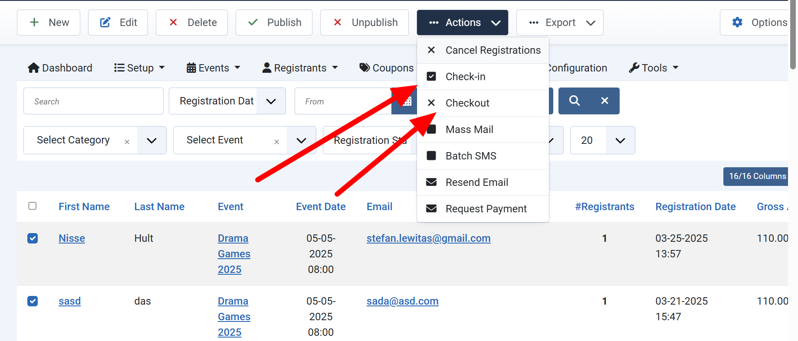
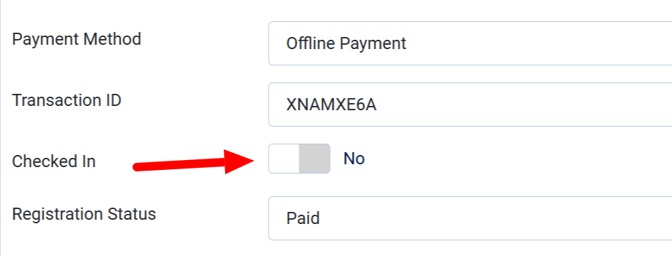

Events Booking support check-in/checkout registrants when they come to attend your event. There are two main methods to check-in registrants:

1. Check-in registrants using QRCODE.
3. Check-in registrants manually.

In this section of document, we only show you how to check-in registrants using manual method. To check-in/checkout registrants manually, you will first have to activate this feature (it's off by default). Go to **Events Booking** -> **Configuration**, set **Activate Checkin Registrants** config option to **Yes**.

## Checkin registrants
To check-in registrants, there are two ways:

1. On Registrants Management screen, check on the checkbox next to registrants you want to check-in, then press **Actions -> Check-in** button in the toolbar
2. Or you can click on a registration record to view the information, then set **Checked In** to **Yes**

## Checkout Registrants

Similar to check-in, there are two ways to checkout registrants:
1. On Registrants Management screen, check on the checkbox next to registrants you want to checkout, then press **Actions -> Checkout** button in the toolbar.
2. Or you can click on a registration record to view the information, then set **Checked In** to **No**

