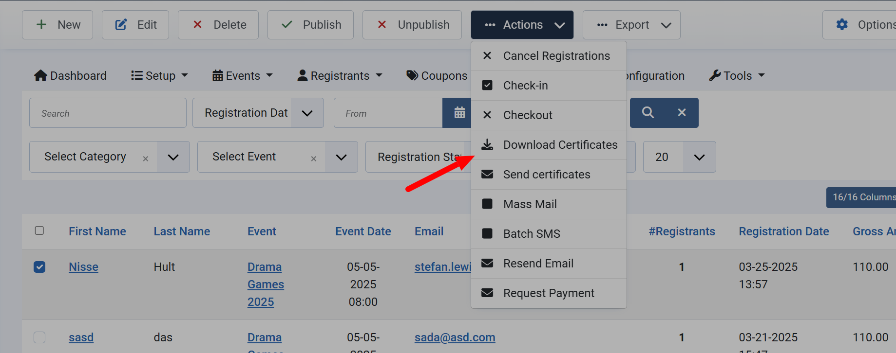

If you use [Certificates Feature](/advanced-features/certificates), you might want to download PDF certificates for certain registration records you want. To do that, from Registrants Management screen:

- Check on the checkbox next to the registration records which you want to download certificate
- Press **Actions -> Download Certificates** button in the toolbar.

When you do that, the system will generate PDF certificate for all selected registration records in a single PDF file and have it downloaded it to your computer. You can use the downloaded file (for example, print these certificates and send it to your registrants).

