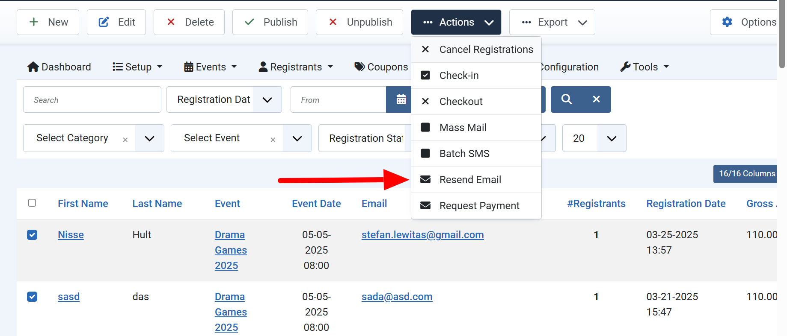

Sometime, you might want to resend confirmation email to your registrant (because they didn't receive email for some reasons during the registration process or when you update their record and want to re-send the confirmation email with updated information of the registration). To do that:

1. Access to Registrants Management screen.
2. Check on the checkbox next to the registrants you want to re-send email. 
3. Press **Actions -> Resend Email** button in the toolbar to resend the confirmation email.

When you do that, the confirmation email will be re-send to registrants. The notification email of that registration will also be resent to administrator, too.

