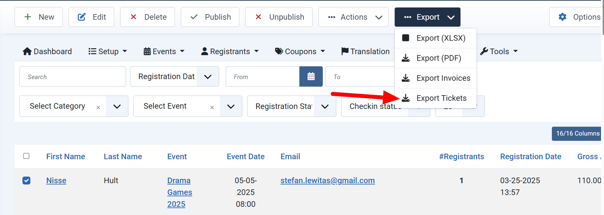

If you activate **Tickets PDF** feature to generate PDF tickets and send to registrants of your event, you might want to export PDF tickets for all or filtered registrants. To do that, from registrants management screen, filter registrants (base on event, status or event select the registration records you want) and press **Actions -> Export Tickets** button in the toolbar.

When you do that, tickets PDF of all filtered registrants will be exported into a single PDF file (each ticket in one page).

