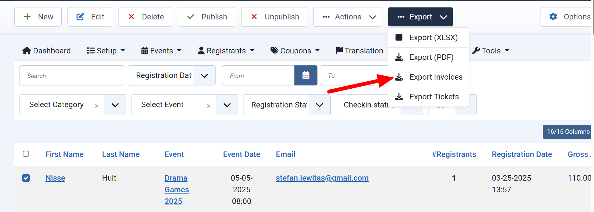

Sometime, you might want to export invoices for all or filtered registrants. To do that, from registrants management screen, filter registrants (base on event, status or event select the registration records you want) and press **Actions -> Export Invoices** button in the toolbar

When you do that, invoices of all filtered registrants will be exported into a single PDF file (each invoice in one page).

