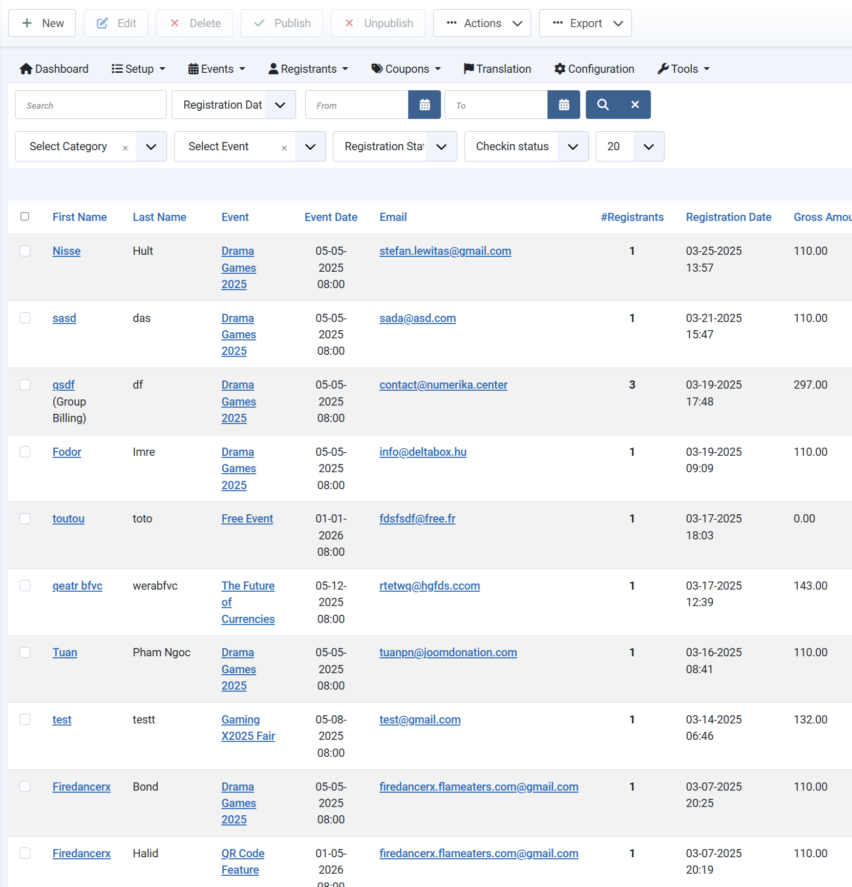
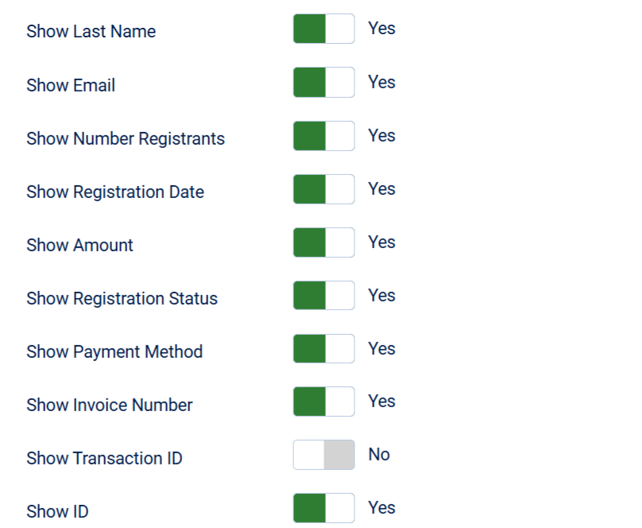
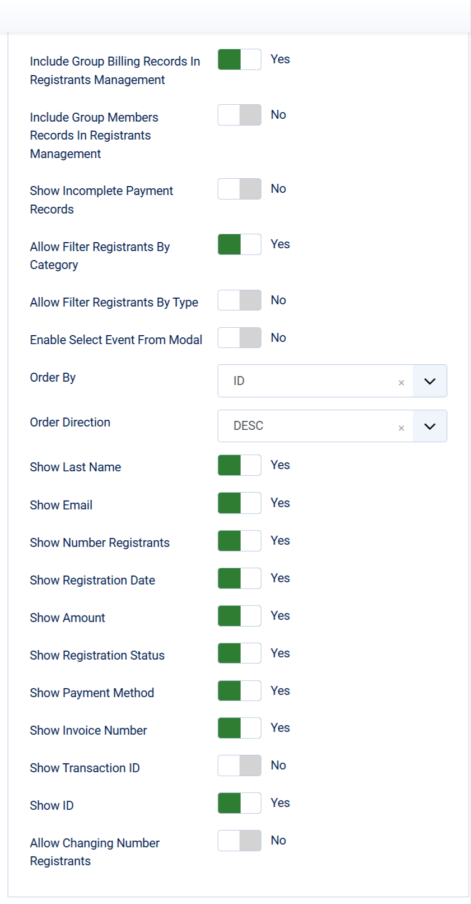

To access to registrants management page, there are 3 different ways:

1. Access to **Components -> Events Booking -> Registrants**
2. Access to Events Booking Dashboard, then click on **Registrants** icon
3. On any pages in Eventts Booking, access to **Registrants** menu option

From this page, you can see list of registration records, filter registration records by events, by registration status, by checkin status (if you use QR Code feature to allow checkin registrants from mobile device), add, edit, publish, unpublish, import, export, send emails... to the registrants.

### Show/Hide group billing/group members
In Events Booking, when someone perform a group registration, beside group members data, the system also stores the group billing data (data of the person who performs the registration). Depends on what's easier for you, you might want to go to Events Booking -> Configuration, look at **Themes** tab, **Registrants Management** section, change the following config options:

- Include Group Billing Records In Registrants Management (default Yes).
- Include Group Members Records In Registrants Management (default No).

### Display More Custom Fields
By default, Events Booking display First Name, Last Name and Email of registrants on Registrants Management screen. If you want to display more custom fields on that page, go to Events Booking -> Custom Fields, edit the custom fields you want, set **Show On Registrants Management** parameter to **Yes** and that custom field will be displayed on the page.

### Show/Hide Some Columns
If you want to show/hide certain columns like **Amount**, **Payment Status**,... on Registrants Management screen, go to Events Booking -> Configuration, look at Themes tab, **Registrants Management** section and choose to Show/Hide the columns you want

### Filter Registrants By Custom Fields

If you create Radio/List/Checkboxes custom fields on registration form and want to filter registrants base on the selected options they choose during registration process, edit these custom field, set **Filterable** parameter of the field to Yes. 

### Change Default Ordering
By default, Events Booking order registrants list by ID in DESC order. That mean latest registrants will be displayed first. If you want to change this default ordering, go to **Events Booking** -> **Configuration**, look at **Themes** tab, **Registrants Management** section, change **Order By** and **Order Direction** parameter to the value you want

