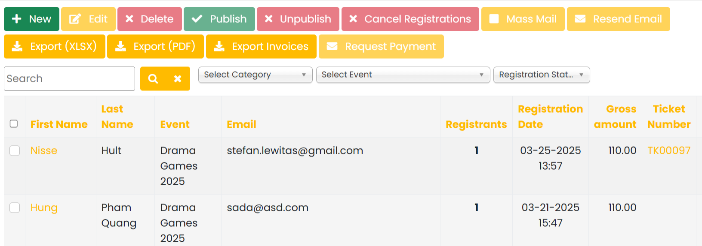
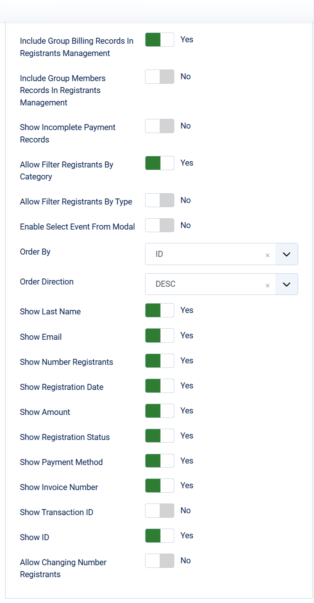

## Manage Registrants
**Events Booking** allow users who granted permission to be able manage registrants from frontend of your site, almost the in the same way with [backend registrants management](/registrants-management) except they cannot import registrants from frontend. You will want to use this feature:

1. If you want to give someone permission to manage registrants but don't want to allow them to access to administrator area of your site.
2. You allow your site users to submit events from frontend of your site, so you need to use this feature to allow them to manage registrants of their own events

Please follow the steps below to setup if you want to use this feature:

## Permission Configuration
You first need to configure your site to allow users from the user groups you want to manage registrants from frontend of your site. Go to **Events Booking -> Configuration** (or any pages in Events Booking in administrator area), click on **Options** button in the toolbar, select the user group(s) you want to allow managing registrants (for example, **Author** group), set **Front-end Registrants Management** permission to **Allowed**. Please note that permission settings in Joomla are inherited, so when you enable this permission for a child group (**Author** in this example), all it's children groups (Editor, Publisher in this example) will have this permission allowed, too.

## Create menu item
Next, you will need to create a menu item to link to **Manage Registrants** menu item type of **Events Booking**. Users can access to that menu item to manage registrants.

## Important Settings
In case you allow users on your site to submit events, you will only want to allow them to manage registrants of their own events only. Go to **Events Booking** -> **Configuration**, set **Only show registrants of events owner** config option to **Yes**. By doing that, users will only see registrants of their own events (events which they submitted). If you want users to manage registrants from all events in your system, set that config option to **No**.

## Customization Options
- Go to **Events Booking** -> **Configuration**, look at **Themes** tab, **Registrants Management** section, you can:
+ Change default ordering of registrants list (by default, it is ordered by ID DESC, mean latest registrants will be displayed first)
+ Choose to show/hide some columns from there
- For custom fields, if you want to show hide certain fields, go to Events Booking -> Custom Fields, click on the field you want, set Show On Registrants Management to Yes/No to have that field show/hide from that page.

