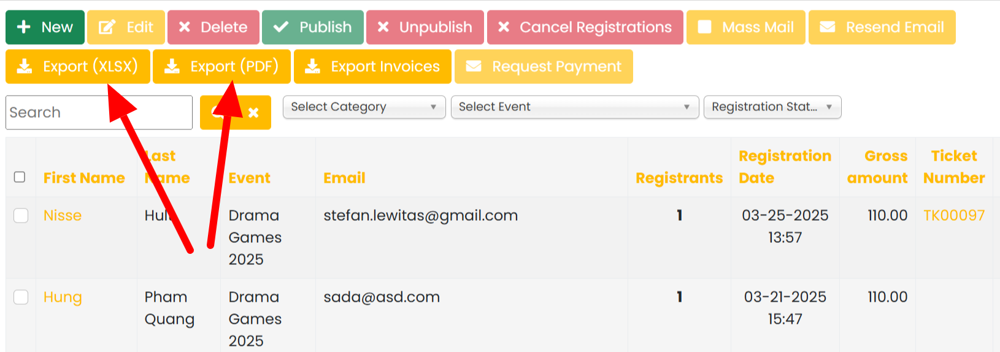

Events Booking allow you to export registrants to Excel file from frontend of your site if they have **Frontend Registrants Management** permission.

1. Users who has registrants management permission can access to [Registrants Management](/frontend-management/manage-registrants) page will be able to export registrants from all events or from the selected event he wants, same way with [exporting registrants from backend](/registrants-management/export-registrants)

2. Users who has registrants management permission or user who created the event, when browse for that event (in events list or event details page) will see an **Export Registrants** button to allow exporting registrants of that specific event.

3. You can create menu item to link to **Export Registrants** menu item type of Events Booking to allow users with [registrants management permission](/frontend-management/manage-registrants#permission-configuration) to click on to export registrants from all events in the system.