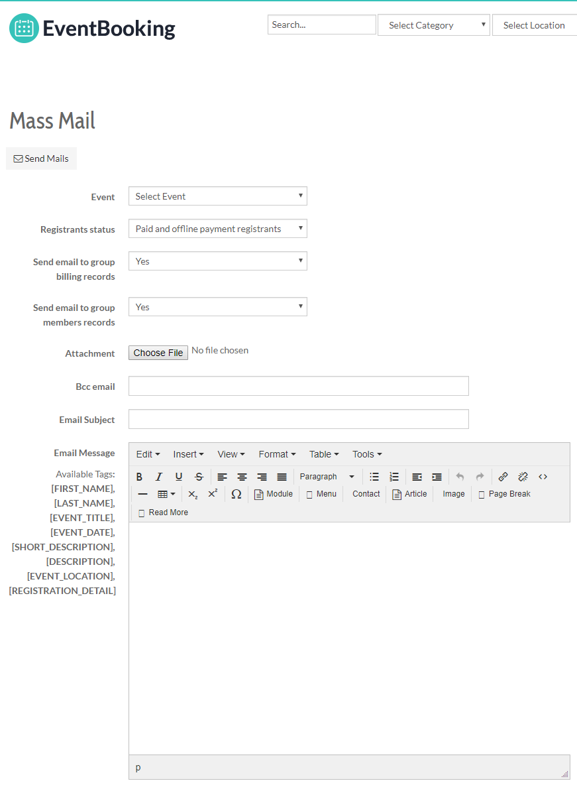

You can use this feature to send emails to all registrants of an event fron frontend of your site.

## Permission Configuration
You will need to config the system to allow users from the user groups you want to have **Front-end Registrants Management** permission as explained on this page [https://docs.joomdonation.com/eventsbooking/frontend-management/manage-registrants#permission-configuration](/frontend-management/manage-registrants#permission-configuration)

## Create Menu Item
Next, you need to create a menu item to link to **Mass Mail** menu option of Events Booking. Users with **Front-end Registrants Management** permission can access to that menu item, see the form below, select event, compose email and sending email to registrants of the selected event. For more information, please read the instructions on [this link ](/registrants-management/mass-mail-registrants) (the feature is the same, one from backend and one is from frontend)

