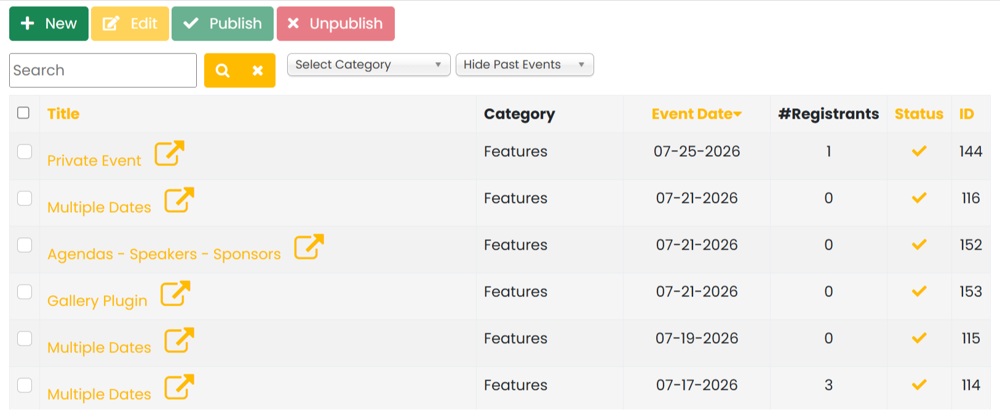

Events Booking allow users to submit and manage their own events from frontend of your site. If you want to enable this feature on your site, please  create a menu item to link to **Manage Events** menu item type of Events Booking. Users can access to that menu item and see a screen like below display all events which they created:

From that page, users can also edit, publish, unpublish the their events. Please also note that if you belong to a group which has **Configure ACL & Options** permission set to **Allowed** in Events Booking, you will see all events in the system when you access to this page.