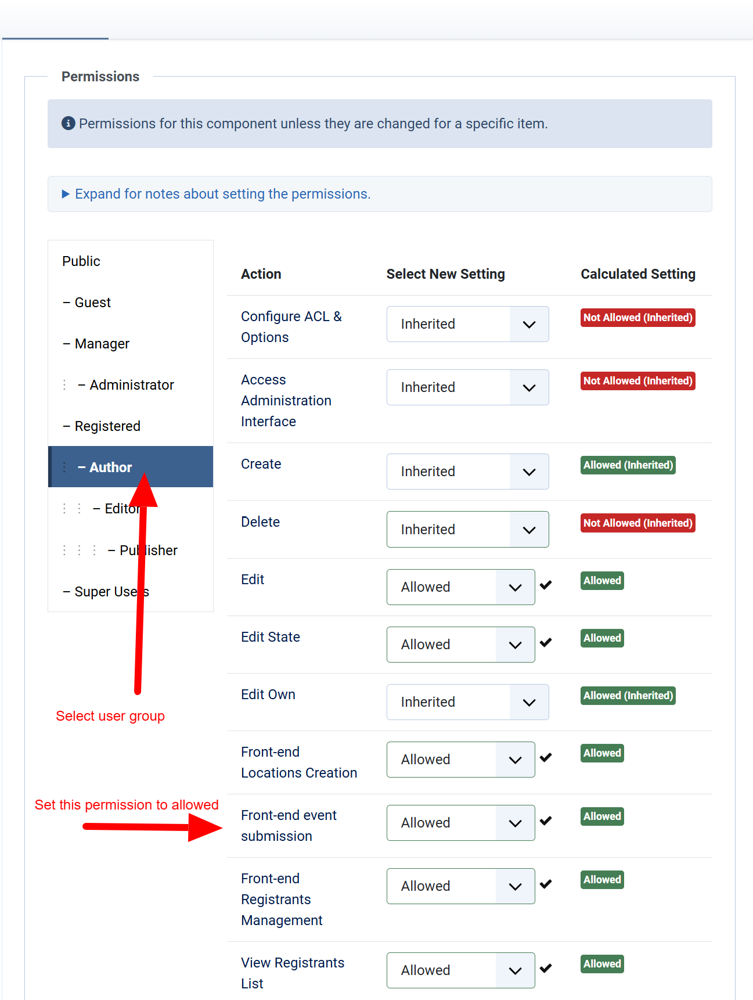
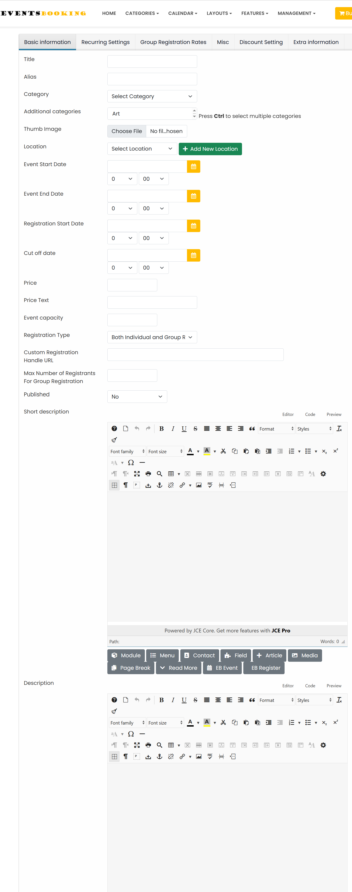
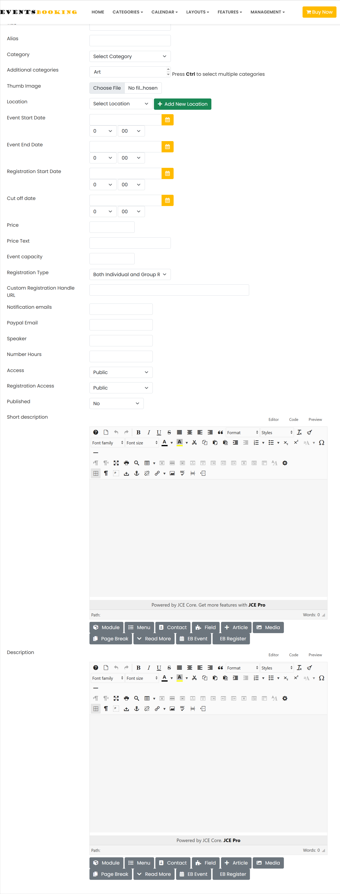
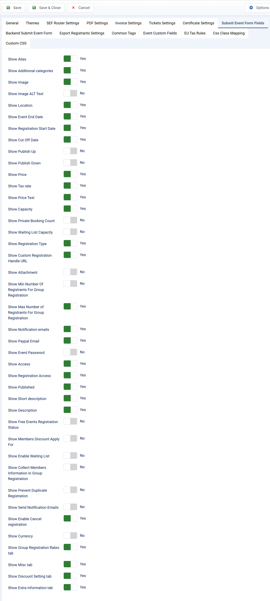

**Events Booking** allows you to setup the system so that users with right permissions will be able to submit and manage their own events from front-end. If you want to allows users to submit events from front-end, please follow the steps below:

## Permission Configuration

You first need to configure your site to allow users to submit events from frontend of your site. Go o **Events Booking -> Configuration** (or any pages in Events Booking in administrator area), click on **Options** button in the toolbar, select the user group(s) you want to allow creating/managing events (for example, **Registered** user group), set **Front-end event submission** permission to **Allowed**. Please note that permission settings in Joomla are inherited, so when you enable this permission for a parent user group (**Registered** in this example), all it's children groups (**Author**, **Editor**, **Publisher** in this example) will have this permission allowed, too.

## Create Menu Item
Next, you will need to create a menu item to link to **Submit Event** or **Submit Event - Simple Layout** menu item type of Events Booking. Users can access to that menu item, enter necessary data on the form to submit event. You should also create a menu item to link to **Manage Events** menu option (see [https://docs.joomdonation.com/eventsbooking/frontend-management/users-events](/frontend-management/users-events) to allow users to click on to manage the events which he submitted.

## Choose submission form layout
Events Booking support two kind of event submission form, **Default layout** and  **Simple layout**. The default layout has most settings like from administrator area. The **Simple layout** is much simpler form and should be consider used if you allow users on your site for submitting events on your site (kind of events services website). If you want to allow someone to manage your own company's events, you might want to use **Default Layout** so that they can have all settings like in the backend.

If you want to use Simple Layout, go to **Events Booking** -> **Configuration**, in **General** tab,set **Frontend Event Submission Form Layout** config option to **Simple Layout**.

**Submit Event Default Layout**

**Submit Event Simple Layout**

## Show/Hide fields on submit event form
The fields on submit event form are configurable. You can go to Events Booking -> Configuration, look at **Submit Event Form Fields** tab, choose to show/hide the fields you want.

## Control status of events submitted from frontend of your site
When users submit an event from frontend of your site, if he belongs to a user group which has Edit State permission in Events Booking set to Allowed, he can choose status (Published/Unpublished) for the events he submit. If he belongs to a group which doesn't have this permission, the status of the event will be based on **Default Event Status** config option in Configuration of Events Booking (unpublished by default). If it is unpublished, admin will need to check and approve/publish the event before it is being shown from frontend of your site

## Locations Settings
Usually, for each event, users will need to select a Location for that event. If you want to allow users to select all available locations from your system for their events, go to Events Booking -> Configuration, look at General tab, set **Show All Locations In Frontend Event Submission Form** config option to **Yes**. If you only want to allow them to choose their own locations, set the above config option to **No**

You should also consider allow users to submit location in frontend so that they can create locations for their own events while submitting events. See https://docs.joomdonation.com/eventsbooking/frontend-management/users-locations#permission-configuration for permission configuration.

## Notification Emails
Events Booking sends notification email to administrator and confirmation email to users when user submit new event from frontend of your site. You can go to Events Booking -> Emails & Messages, look at **Submit Event Email Messages** and change the following email messages to meet your need if needed:

**User Email Subject**
**User Email Body**
**Admin Email Subject**
**Admin Email Body**

You can use the following tags for these messages:
- **[NAME]** (Name of user who submit event)
- **[USERNAME]** (Username of user who submit event)
- **[EVENT_TITLE]**
- **[EVENT_DATE]**
- **[EVENT_ID]**
- **[EVENT_LINK]** (Link to view event from administrator area of your site)
