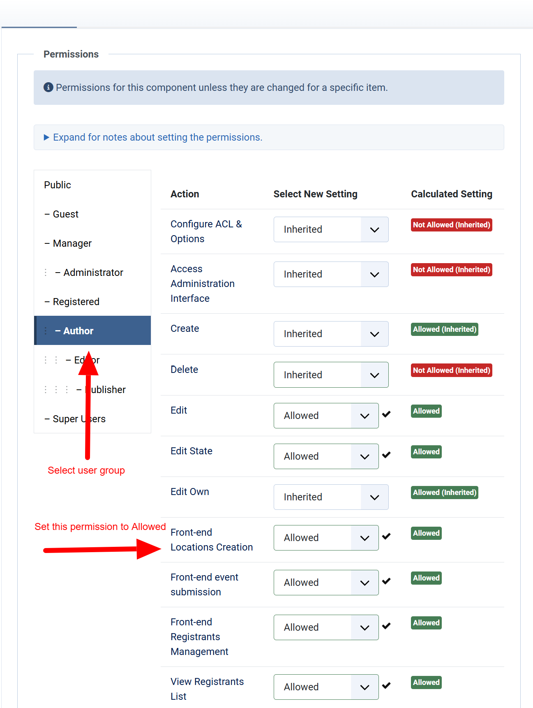
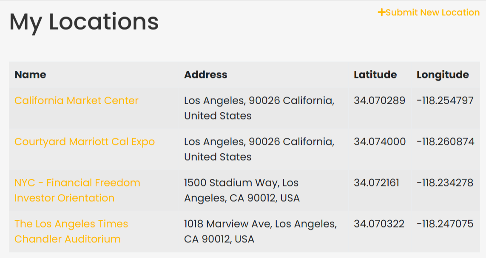

Events Booking allow users to submit and manage locations of their own events from frontend of your site. If you want to enable this feature on your site, please follow instructions below:

## Permission configuration

You first need to configure your site to allow users to add/manage locations from frontend of your site. Go o Events Booking -> Configuration (or any pages in Events Booking in administrator area), click on Options button in the toolbar, select the user group(s) you want to allow creating/managing locations (for example, Registered group), set **Front-end Locations Creation** permission to **Allowed**. Please note that permission settings in Joomla are inherited, so when you enable this permission for a child group (Registered in this example), all it's children groups (Author, Editor, Publisher in this example) will have this permission allowed, too

## Create menu item
Next, you will need to create a menu item to link to **Manage Locations** menu item type of Events Booking. Users can access to that menu item and see a screen like below display all locations which they created:

From that page, users can see list of locations which he created, add new location and update an existing location.