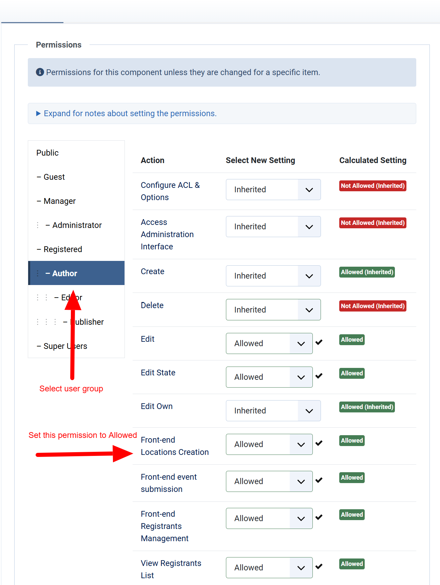
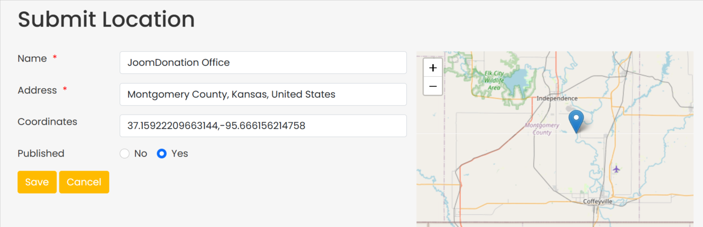

Beside create a menu item to display user's locations and allow users to create location from frontend of your site, you can also create a menu item to allow users to click on to create new locaton directly. If you want to enable this feature on your site, please follow instructions below:

## Permission configuration

You first need to configure your site to allow users to add locations from frontend of your site. Go o Events Booking -> Configuration (or any pages in Events Booking in administrator area), click on Options button in the toolbar, select the user group(s) you want to allow creating/managing locations (for example, Registered group), set **Front-end Locations Creation** permission to **Allowed**. Please note that permission settings in Joomla are inherited, so when you enable this permission for a child group (Registered in this example), all it's children groups (Author, Editor, Publisher in this example) will have this permission allowed, too.

## Create menu item
Next, you will need to create a menu item to link to **Submit Location** menu item type of Events Booking. Users can access to that menu item will see a form like below to allow them to create new location. He can later, select these locations for the events which he submit from frontend of your site.

