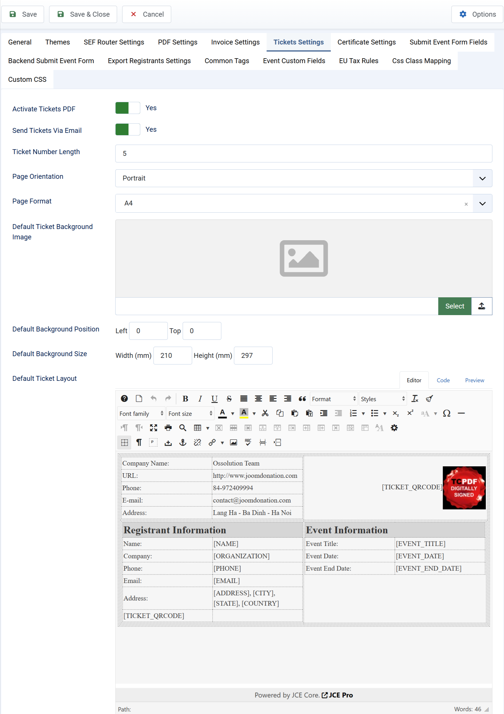
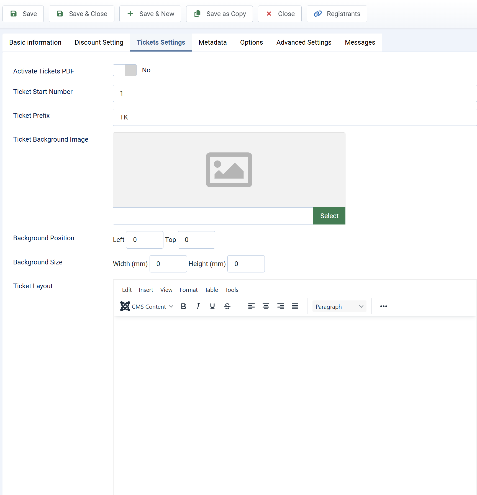

Events Booking allow you to design, generate PDF tickets and send it to registrants when they register for your event. Registrants can then print that ticket, bring it to the event and uses it for checking in.

## Enable Tickets PDF feature
Tickets PDF is disabled by default. If you want to use this feature, please go to Events Booking -> Configuration, look at **Tickets Settings** tab, set **Activate Tickets PDF** config option to Yes. You can also setup some other parameters of the ticket such as Page Format, Page Orientation, Background image....

## Enable Tickets PDF for each event
Tickets PDF feature can be On/Off on individual event basis. If you enable Tickets PDF in configuration, When you create/edit an event, you will see a tab caled Tickets Settings. Set **Activate Tickets PDF** parameter to **Yes** if you want Events Booking to generate PDF tickets for this event. You can also control some other parameters such as **Tickets Start Number**, **Tickets Prefix**, select **Background Image** (if you don't select, the background in Configuration will be used), design **Ticket Layout** (if you don't design ticket layout for the event, the default ticket layout in Configuration will be used)

## Supported tags
Below are list of all the tags which you can use to design your ticket

### Event Information tags
- [EVENT_TITLE]
- [EVENT_DATE]
- [EVENT_DATE_DATE] (show date of event without time)
- [EVENT_DATE_TIME]
- [EVENT_END_DATE]
- [EVENT_END_DATE_DATE]
- [EVENT_END_DATE_TIME]
- [SHORT_DESCRIPTION]
- [DESCRIPTION]
- [EVENT_CAPACITY]
- [INDIVIDUAL_PRICE]
- [PRICE_TEXT]
- [LOCATION]
- [LOCATION_NAME]

### Registration information
- [ID] (ID of the registration record)
- [FIRST_NAME]
- [LAST_NAME]
- [NAME] (combination of first_name + last_name)
- Any custom fields using the syntax [NAME_OF_FIELD_IN_UPPERCASE], for example, if you have a custom field name registration_type, then the tag is [REGISTRATION_TYPE]
- [COUPONCODE]
- [USERNAME]
- [USER_ID]
- [NUMBER_REGISTRANTS]
- [GROUP_MEMBERS_NAMES]
- [INVOICE_NUMBER]
- [TOTAL_AMOUNT]
- [DISCOUNT_AMOUNT]
- [TAX_AMOUNT]
- [PAYMENT_PROCESSING_FEE]
- [AMOUNT] (This is the final payment amount users have to pay, amount after discount, tax...)
- [DEPOSIT_AMOUNT]
- [DUE_AMOUNT]
- [PAYMENT_METHOD]
- [PAYMENT_DATE]
- [TRANSACTION_ID]
- [REGISTRATION_STATUS]
- [TICKET_TYPES] (if you are using Ticket Types feature)

### Tickets information
- [TICKET_NUMBER]
- [REGISTER_DATE]

## How Tickets PDF is generated

1. Tickets will be generated when status of the registration record is Paid. That mean it will be generated when users register and paid for the registration. In case they use offline payment, tickets will only be generated when admin receive payment and approve the registration.
2. For Individual registration, the system will generate one ticket. For group registration, the system will generate one ticket for each group member
3. If you use shopping cart, users can register for multiple events. For each event they register, the system will generate one ticket.

## Deliver PDF tickets to registrants
1. Go to Events Booking -> Configuration, look at Tickets Settings tab, find the config option **Send tickets via email**, set it to **Yes** and tickets will be generted and send to registrant's email
2. If you don't want to deliver the ticket via email, you can edit the email message which is sent to registrants, insert **[DOWNLOAD_TICKET_LINK]** . Then registrants can click on the link to download the ticket
3. If registrants have an account on your website, they can login, access to Registration History to see their registration history and download PDF ticket from there
4. You can configure the system to send [reminder email ](/basic-setup/auto-reminder) to your registrants. In the email, you can insert **[DOWNLOAD_TICKET_LINK]** tag to send link to download ticket to registrant 