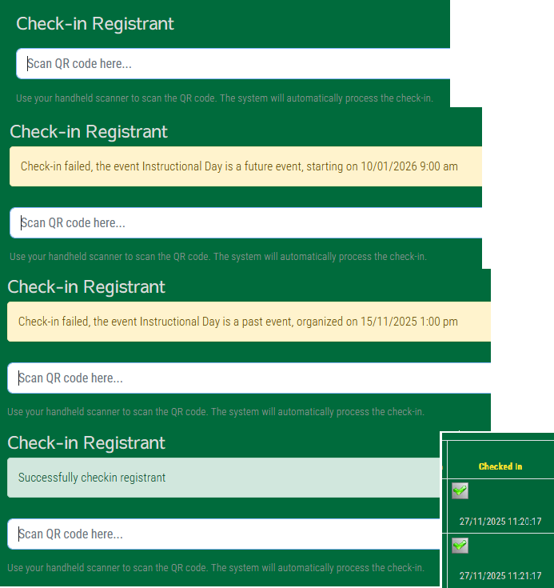

**Events Booking** supports generating QRCODE for each registration and use that QRCODE to checkin registrants when they come and attend your events.

## How it works
1. When registrants register for an event, Events Booking will generate a QRCODE (which points to an unique URL in Events Booking to check-in that registrant). That QRCODE will be displayed on the thank you message and in the email sent to registrant after he completes the registration
2. The registrant print that thank you message (or confirmation email) contains the QRCODE, bring it as the ticket to the event
3. When you receive that ticket, you can use your smartphone (which has a QRCODE reader APP installed) to scan that QRCODE:
* If the QRCODE is valid, the registrant will be successfully checked in (stauss changed to checked in) and there will be a success message displayed so that you know that this ticket is valid
* For individual registration, each QRCODE can be checkedin one time only
* For group registration, each QRCODE can be checked in in X-times (X equals to number of registrants in the group).
* If the QRCODE is invalid (invalid code or it was used for checked in before), the system will display a failed message and you know that the ticket is invalid.

## Checkin Registrants Using Built-In QRCODE Scanner
Events Booking has a built-in QRCODE scanner which you can use to check-in registrants. With this built-in scanner, you do not have to install any mobile app for checking in registrants. This is a recommended method for checkin registrants in Events Booking.

**To use this method**:
- Insert **[TICKET_QRCODE]** tag into **Thank you message** or **User Email Body** message or **invoice layout** or **Ticket PDF layout** (if you are using tickets PDF feature) in Events Booking.
- Create a menu item to link to **QRCODE Scanner** menu item type of Events Booking. By default, the system set time between too scans/checkins to 15 seconds (to avoid to many checkin requests performed in a short time, could be unexpected behavior). If you want to scan tickets faster (for example, time between checkin two registrants to 5 seconds), you can change **Checkin Interval** parameter to 5. This menu item should only be visible to users from group which has Registrants Management permission.
- Using the browser from your mobile, login to your site using an account which has **Registrants Management** permission. Then access to that menu item above, press **Start Scanning** button to request permission to use your phone camera to checkin.
- Each time you want to check in someone, just scan their tickets using the QRCODE scanner from the above page.

**Events Booking** supports generating QRCODE for each registration and use that QRCODE to checkin registrants when they come and attend your events.

## How it works
1. When registrants register for an event, Events Booking will generate a QRCODE (which points to an unique URL in Events Booking to check-in that registrant). That QRCODE will be displayed on the thank you message and in the email sent to registrant after he completes the registration
2. The registrant print that thank you message (or confirmation email) contains the QRCODE, bring it as the ticket to the event
3. When you receive that ticket, you can use your smartphone (which has a QRCODE reader APP installed) to scan that QRCODE:
* If the QRCODE is valid, the registrant will be successfully checked in (stauss changed to checked in) and there will be a success message displayed so that you know that this ticket is valid
* For individual registration, each QRCODE can be checkedin one time only
* For group registration, each QRCODE can be checked in in X-times (X equals to number of registrants in the group).
* If the QRCODE is invalid (invalid code or it was used for checked in before), the system will display a failed message and you know that the ticket is invalid.

## Checkin Registrants handheld scanner 
It works similar with **Checkin Registrants Using Built-In QRCODE Scanner** described above. You create a menu item to link to **Handheld QRCODE Scanner** menu item type of Events Booking. Users with registrants management permission will be allowed to access to that menu item, see a form with a text input. When the handheld scanner scan QRCODE, the ticket code will be added to the input, the form will be submitted and display check-in result 

## Checkin Registrants Using QRCode Plus app
The [QRCode Plus](https://apps.apple.com/app/id937791963) is a free **IOS** app which can be used to checkin registrants in Events Booking. This is the recommended method because:
- The app is free. So you do not have to purchase a mobile app for checking in registrants
- It is fast and simple to checkin registrants using this app
- You do not have to login to frontend of your site to checkin registrants

**To use this method**:
- Install that app to your IOS device (IPhone or Ipad)
- Insert **[TICKET_QRCODE]** tag into **Thank you message** or **User Email Body** message or **invoice layout** or **Ticket PDF layout** (if you are using tickets PDF feature) in Events Booking.
- Go to Events Booking -> Configuration, enter a random string into **Checkin API Key** config option.
- Configure the **QRCode Plus** app which you installed. Enter the parameters below:
+ URL: Enter https://domain.com/index.php?option=com_eventbooking&task=scan.qr_code_plus&api_key=[API_KEY] . Of course you need to replace https://domain.com with URL of your site. [API_KEY] needs to be replaced with the string you entered in **Checkin API Key** config option.
+ **Method**: Choose **Post**.
+ **Key Name**: Set to **code**
- When registrants give you the ticket, you can scan the QRCODE in the ticket to process checkin registrants as described in **How it works** section above.

## Checkin registrants using CodeREADr mobile app
This method can only be used if you are using Tickets PDF feature. Below are the steps using CodeREADr mobile app & service [https://www.codereadr.com/](https://www.codereadr.com)
- Each ticket generated has an unique code. It is a random string with 32 characters length
- When you design the ticket, remember to use **[TICKET_QRCODE]** tag. Events Booking will then generate QRCODE for the ticket with the unique ticket code above
- Go to Events Booking, Registrants, select the event you want, then export registrants into CSV/Excel file. Before exporting, please go to Events Booking -> Configuration, set Include Group Billing Records in Registrants Management to No so that only group members will be exported
- Sign up for an account on https://www.codereadr.com/
- Download and install the mobile APP provided in the website
- Follow the first three steps on this page https://www.codereadr.com/kb/databases/ to prepare and import registrants into the website
-Now, you can use their mobile APP for checkin registrants/

## Checkin registrants Using QRCODE reader APP
This method has some disadvantages compare to use iCODY APP:
- It requires you to login to frontend of your site while scanning QRCODE
- It opens your mobile web browser to run the scanned URL returned by QRCODE each time you scan QRCODE from ticket.
- As you can imagine, it is much slower compare to use iCODY APP. So this should only be used if you don't have too much registrants.

**To use this method**
1. You insert **[QRCODE]** tag into **Thank you message** or **User Email Body** message or **invoice layout** or **Ticket PDF layout** (if you are using tickets PDF feature) in Events Booking.
2. Registrants can print one of the item above (image, invoice, ticket) (depends on which one to use) and bring as a ticket to the event
3. The person who has responsibility to check-in registrants will:
* Login to the frontend of your site using a mobile device which can scan QR code (such as Iphone). We test it using Iphone and use this APP https://itunes.apple.com/us/app/qr-code-reader-by-scan/id698925807?mt=8 for scanning QR code. Feel free to use any QRCODE reader APP you like
* The account which used to login **must be a super admin account or an account which as Registrants Management** in Events Booking
* When registrants give him the ticket, he can use the QRCODE reader APP above to scan that QRCODE to check-in registrant

## Check-in registrants manually
If you simply want to see manage who has checked in, who has not, you can simply access to backend of your site, filter the Registrants by Event and Checked in status

You can also check in registrants manually, see instructions at [https://docs.joomdonation.com/eventsbooking/registrants-management/checkin-checkout-registrants](/registrants-management/checkin-checkout-registrants)

## Display Registrants Information In Checkin Messages

When you checkin registrants use QRCODE, the system will display checkin result messages. It is controlled by one of the message items below:

- EB_INVALID_REGISTRATION_RECORD
- EB_REGISTRANT_ALREADY_CHECKED_IN
- EB_CHECKED_IN_FAIL_REGISTRATION_CANCELLED
- EB_CHECKED_IN_SUCCESSFULLY
- EB_CHECKED_IN_REGISTRATION_PENDING
- EB_CHECKED_IN_PAST_EVENT
- EB_CHECKED_IN_FUTURE_EVENT

If you want to change the message, go to Events Booking -> Translations, find these language items and change it to meet your need. You can tags such as [FIRST_NAME], [LAST_NAME]... (basically, same with the tags with you can use in email to display any information you want). See [Common Tags](/email-tags/common-tags) for the tags which you can use
