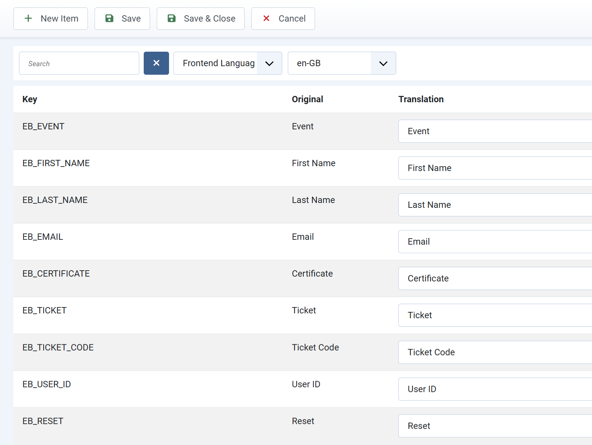
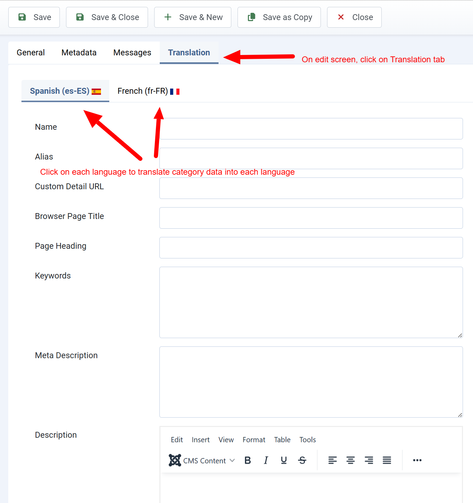
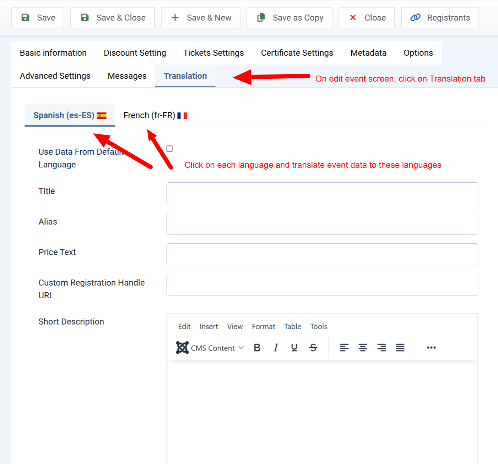
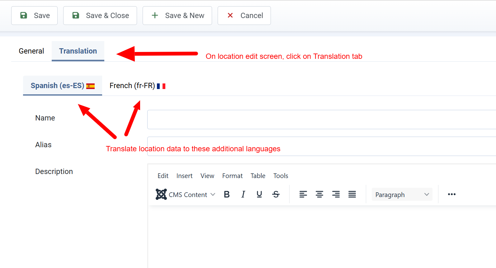
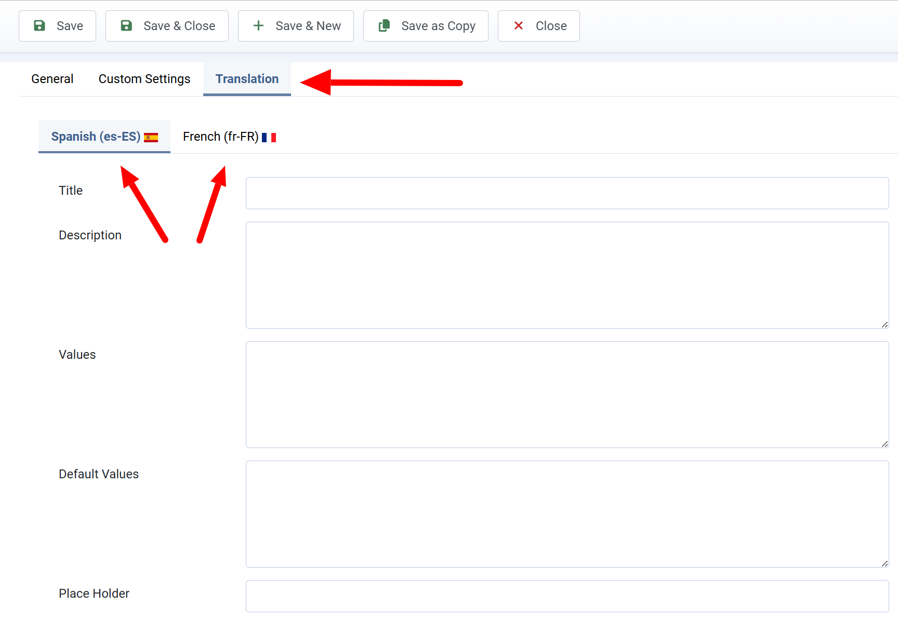
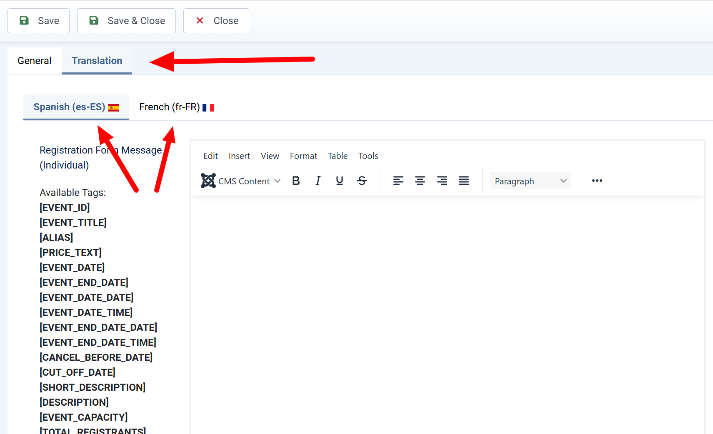

**Events Booking** support multilingual out of the box, and I am proud to say that it is implemented in a better way than Joomla core. Basically, in Joomla core, for each item (for example, each article), you will have to setup different records, each record for one language

However, in **Events Booking** you will only have to create one record, then translate to different languages in Translation tab in add/edit record screen.

To setup **Events Booking** on a multilingual website, you will need to do the translation on a different places below:

## Translate language items

To that, go to **Events Booking -> Translation**, translate the language items used in the extension to all languages used on your site

## Translate categories

On Categories Management screen, click on a category to edit. Look at **Translation** tab, translate the category to all other languages (beside default language) used on your site

## Translate Events

On Events Management screen, click on an event to edit. Look at **Translation** tab, translate the event to all other languages (beside default language) used on your site.

## Translate Locations
On Locations Management screen, click on a location to edit. Look at **Translation** tab, translate the location to all other languages (beside default language) used on your site.

## Translate Custom Fields

On Custom Fields Management screen, click on a custom field to edit. Look at **Translation** tab, translate the custom field to all other languages (beside default language) used on your site.

## Translate Emails & Messages
The final part you have to translate is **Emails & Messages**. Access to **Events Booking -> Emails & Messages**, click on each message item to edit and translate these message items to all other languages (beside default language) used on your site.

>>>>>> Sometime, you might see an SQL error when your site is a multilingual website because the database tables lack some require fields to support multilingual. If that's the case, please access to **Tools => Fix Database Schema**. After that, the error should be gone.