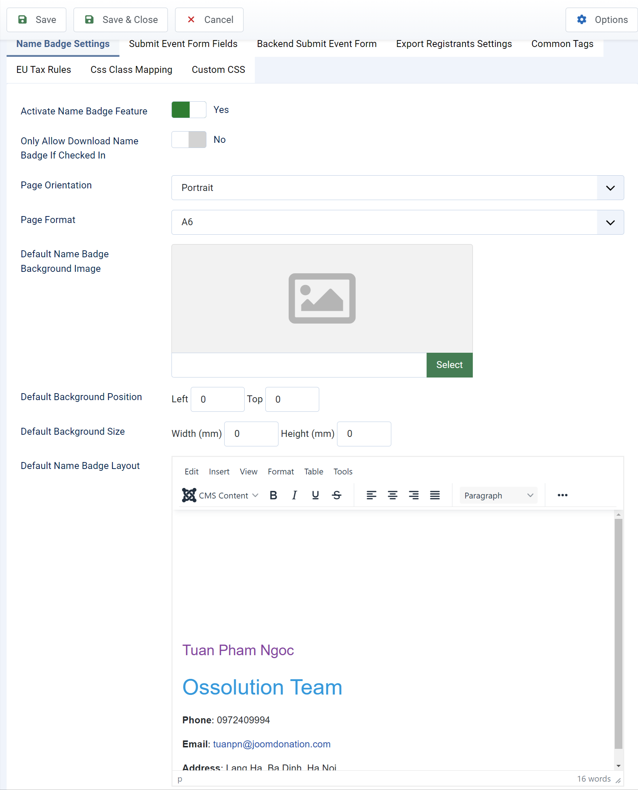
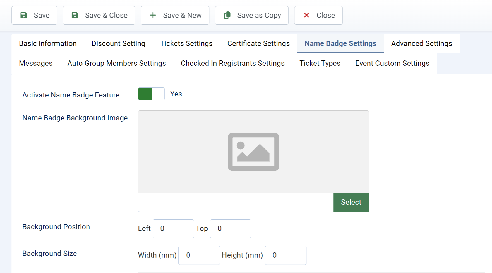

**Events Booking** allow you to design, generate **Name Badges** and sends it to registrants when they come and attend your events. If you need this feature, please follow instructions below to setup and use it.

This feature is not yet available on Public Release. I write the documentation here quickly to guide potential customer to use and get feedback from them and we might include this in core package in the future.

## Enable Name Badge
Name Badge is disabled by default. If you want to use this feature, please go to Events Booking -> Configuration, look at Name Badge Settings tab, set **Activate Name Badge Feature** config option to **Yes**. You can also setup some other parameters of the name badge such as Name Badge Layout,  Page Format, Page Orientation, Background image....

If the Name Badge layout are the same for all events, you should design **Name Badge Layout**, **Background Image**... in this configuration page and it will be used as default settings for all events.

## Enable Name Badge For Each Event
**Name Badge** can be On/Off on individual event basis. If you enable Name Badge in configuration, When you create/edit an event, you will see a tab called Name Badge Settings. Set **Name Badge** parameter to **Yes** if you want to generate Name Badge for registrants of this event. You can also change Name Badge settings for this specific event if you want to override the default global settings above.

## Supported tags
Below are list of all the tags which you can use to design your certificate

### Event Information tags
- [EVENT_TITLE]
- [EVENT_DATE]
- [EVENT_DATE_DATE] (show date of event without time)
- [EVENT_DATE_TIME]
- [EVENT_END_DATE]
- [EVENT_END_DATE_DATE]
- [EVENT_END_DATE_TIME]
- [SHORT_DESCRIPTION]
- [DESCRIPTION]
- [EVENT_CAPACITY]
- [INDIVIDUAL_PRICE]
- [PRICE_TEXT]
- [LOCATION]
- [LOCATION_NAME]

### Registration information
- [ID] (ID of the registration record)
- [FIRST_NAME]
- [LAST_NAME]
- [NAME] (combination of first_name + last_name)
- Any custom fields using the syntax [NAME_OF_FIELD_IN_UPPERCASE], for example, if you have a custom field name registration_type, then the tag is [REGISTRATION_TYPE]
- [COUPONCODE]
- [USERNAME]
- [USER_ID]
- [NUMBER_REGISTRANTS]
- [GROUP_MEMBERS_NAMES]
- [INVOICE_NUMBER]
- [TOTAL_AMOUNT]
- [DISCOUNT_AMOUNT]
- [TAX_AMOUNT]
- [PAYMENT_PROCESSING_FEE]
- [AMOUNT] (This is the final payment amount users have to pay, amount after discount, tax...)
- [DEPOSIT_AMOUNT]
- [DUE_AMOUNT]
- [PAYMENT_METHOD]
- [PAYMENT_DATE]
- [TRANSACTION_ID]
- [REGISTRATION_STATUS]
- [TICKET_TYPES] (if you are using Ticket Types feature)
- [REGISTER_DATE]

## Download Name Badge For Registrants
You can go to Events Booking -> Registrants, filter for the Registration Records you want to generate Name  Badge, then click on **Actions -> Download Name Badges** button in the toolbar to generate Name Badges for these filter registrants. If you want to download badges for certain registrants only, check on the checkbox next to the registration records you want before clicking on Download Name Badges button.

## Allow Registrants To Download Name Badge

If you want to allow registrants to download Name Badges themself, you can insert the tag [DOWNLOAD_NAME_BADGE_LINK] into the email message you want (for example, registration completed email or checked in success email....). Registrants can then click on the link to download the badge themself

If you use checked in registrants using QRCODE feature, you can also insert that tag into checked in success message and download the Name Badge, print it and send to your registrant after they are successfully checked in.