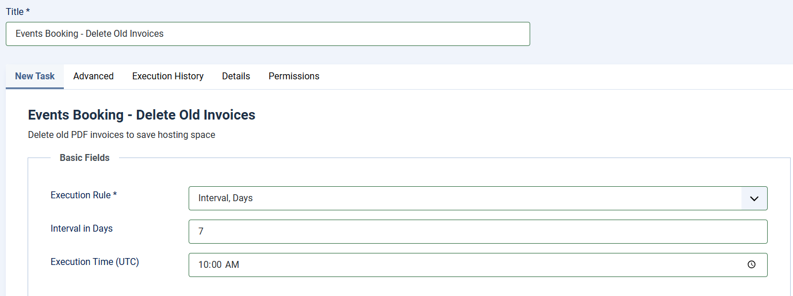
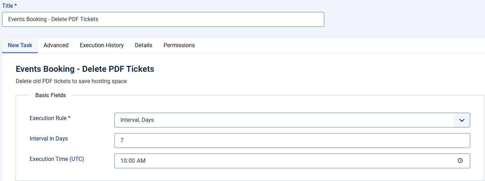
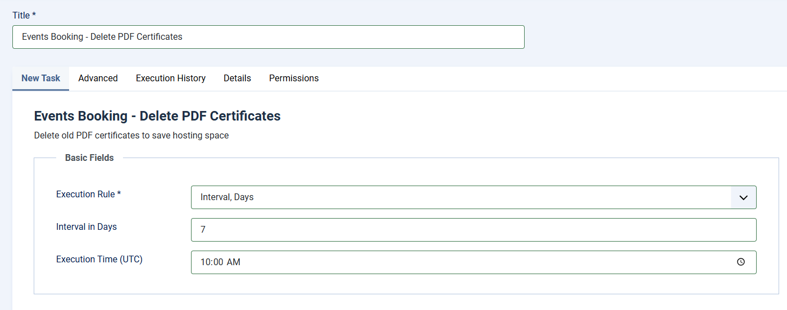
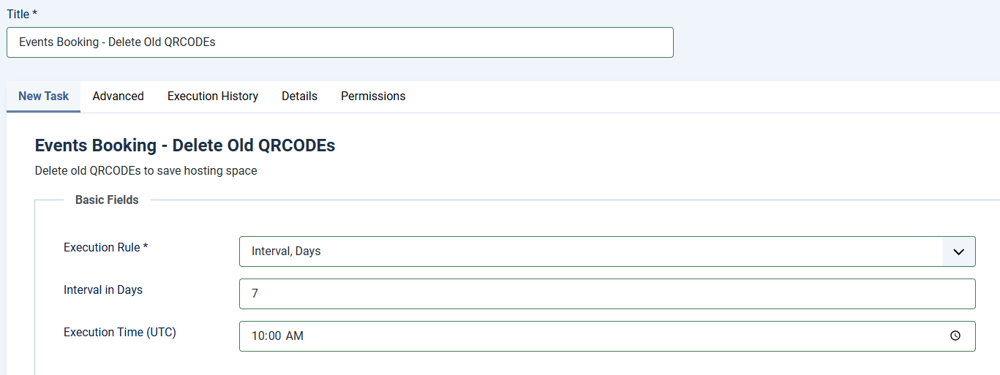
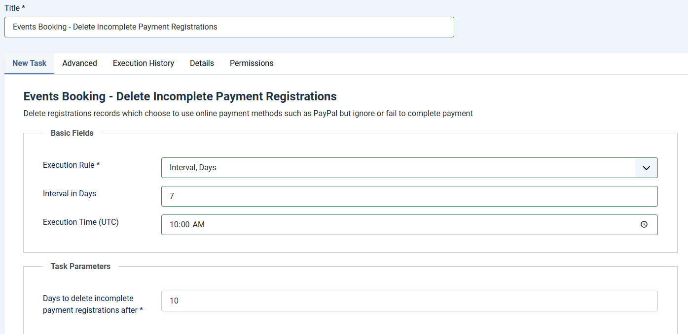
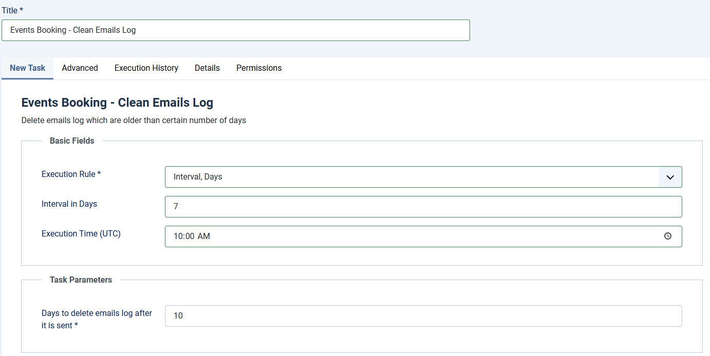

The plugin **Task - Events Booking House Keeping** is a Joomla Task Scheduler plugin to perform various clean up to Events Booking database and storage like deleting old invoices, tickets, certificates, remove registration records which use online payment methods but did not process payment....Go to **System** -> **Plugins**, find and enable **Task - Events Booking House Keeping** plugin. Then access to **System - Scheduled Tasks**, press **New** button to create task to perform data clean up operation:

## Events Booking - Delete Old Invoices

Create this scheduled task to delete old **PDF Invoice** files generated by Events Booking. Each time an invoice is generated, a PDF file is left on server, costs hosting space and should be deleted.

## Events Booking - Delete PDF Tickets

Create this scheduled task to delete old **PDF Ticket** files generated by Events Booking. Each time a ticket is generated, a PDF file is left on server, costs hosting space and should be deleted.

## Events Booking - Delete PDF Certificates

Create this scheduled task to delete old **PDF Certificate** files generated by Events Booking. Each time certificate is generated, a PDF file is left on server, costs hosting space and should be deleted.

## Events Booking - Delete Old QRCODEs

Create this scheduled task to delete old **QRCODE** files generated by Events Booking. Each time QRCODE is generated, a PDF file is left on server, costs hosting space and should be deleted.

## Events Booking - Delete Incomplete Payment Registrations
When someone registers for your events and use online payment method such as PayPal to process payment but ignore payment, the registration is invalid and not being counted as registrants in Events Booking. However, the data for these registrations will still be stored in database, cost space, and you might want to delete it to have data store in database table cleaned up. To do that, create an a scheduled task of **Events Booking - Delete Incomplete Payment Registrations** task type

## Events Booking - Clean Emails Log
If you have **Log Emails** config option to Yes, each time Events Booking process sending email, a copy of that email will be stored in database and you might want to delete these emails to save hosting space. To do that, create a scheduled task of **Events Booking - Clean Emails Log** task type.

