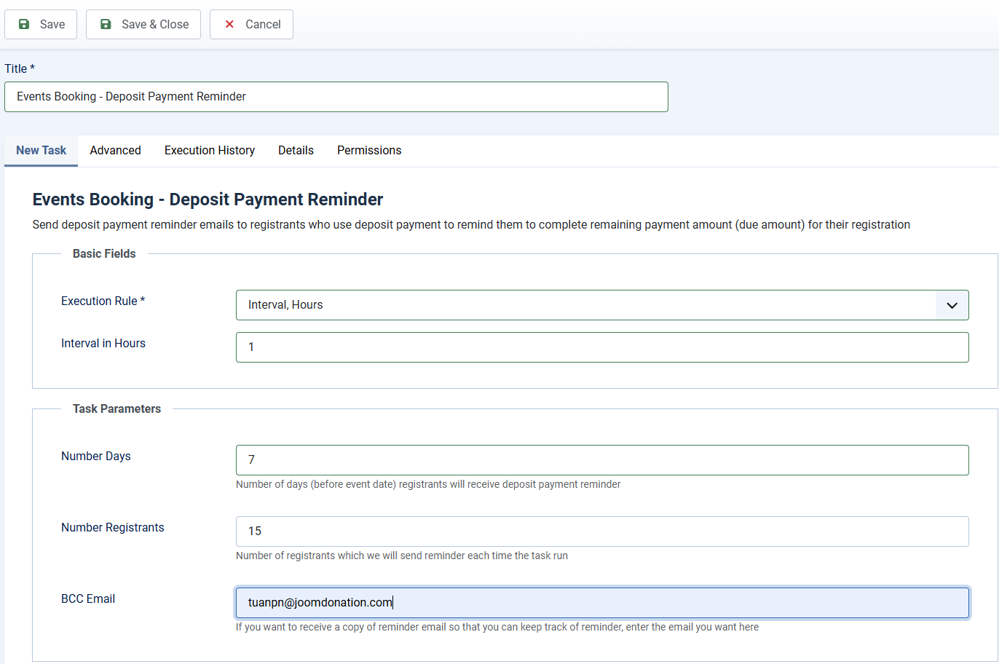

If you enable [**Deposit Payment**](/basic-setup/deposit-payment) for your events, you can use use this scheduled task to send reminders emails to registrants to remind them to complete remaining payment for the registration if that remaining payment amount is not received certain number of days before event date:

1. Go to **System -> Plugins**, make sure **Task - Events Booking** plugin is enabled.
2. Go to **System -> Scheduled Tasks**, press **New** button in the toolbar to create a new scheduled task for **Events Booking - Deposit Payment Reminder** task type.
3. Setup all required parameters, save it.

## Task Basic Fields
This scheduled task should be run several times per day. Each time it runs, it will process to 10 - 15 registrants, so you can setup **Basic Fields** to following values

- **Execution Rule**: Set to **Interval, Hours**
- **Interval in Hours**: Set to the number you want, for example, if you set it to 1, the task will be run every 1 hour.

## Task Parameters
- **Number Days**: Enter Number of days (before event date) registrants will receive deposit payment reminder if they still haven't completed remaining payment for the registration.
- **Number Registrants**: Number of registrants the system will process each time the task is executed. You should not set it to a high number to avoid timeout, set it to 10 to 20 should be enough.
- **BCC Email**: If you want to receive a copy of the emails sent to registrants, enter your email here. Please note that you can leave it empty or enter a sinle email here

## Setup Email Subject and Email Body

Go to **Events Booking -> Emails & Messages**, find and change the following message items to customize the subject and body of the email if needed:

- **deposit_payment_reminder_email_subject**
- **deposit_payment_reminder_email_body**