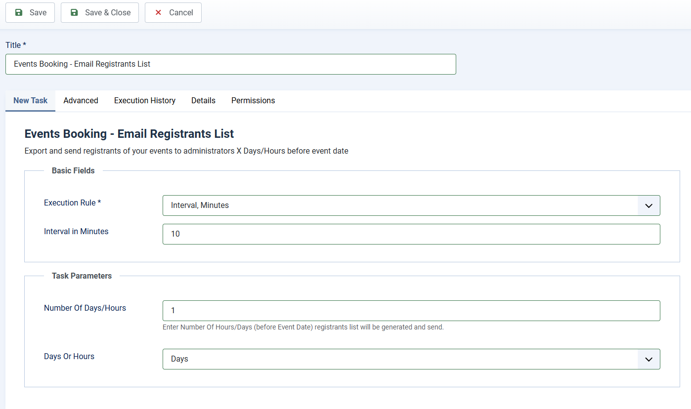

This scheduled task automatically exports the registrants of each event to an Excel file and emails it to the administrators X days or hours before the event starts. To use this feature:

1. Go to **System -> Plugins**, make sure **Task - Events Booking** plugin is enabled.
2. Go to **System -> Scheduled Tasks**, press **New** button in the toolbar to create a new scheduled task for **Events Booking - Email Registrants List** task type.
3. Setup all required parameters, save it.

## Task Basic Fields
Each time the task is executed, it will only send registrants list of one event. So if you have many events per day, this task should be run every 10 or 20 minutes for example, so you can setup **Basic Fields** to following values:

- **Execution Rule**: Set to **Interval, Minutes**
- **Interval in Minutes**: Set to the number you want, for example, if you set it to 10, the task will be run every 10 minutes.

## Task Parameters
- **Number Of Days/Hours**: Enter Number Of Hours/Days (before Event Date) registrants list will be generated and sent to administrators..
- **Days Or Hours**: If you set it to Days, registrants list will be generated and send X days before Event Date. Similar, if you set it to Hours, registrants list will be sent X hours before Event Date.

## Setup Email Subject and Email Body

Go to **Events Booking -> Emails & Messages**, find and change the following message items to customize the subject and body of the email if needed:

- **send_registrants_list_email_subject**
- **send_registrants_list_email_body**