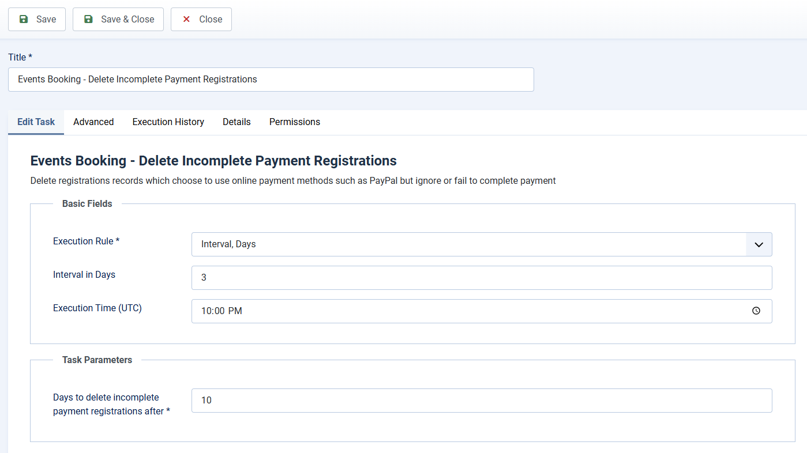

This scheduled task is used to remove the registration records which choose to use online payment methods such as PayPal, Stripe.... but did not complete payment (ignore payment process or payment failed for whatever reasons) after certain (configurable) number of days. That help clean up unnecessary data store in database tables, thus save hosting space. To use this feature:

## Create and configure the scheduled task

1. Go to **System -> Plugins**, make sure **Task - Events Booking** plugin is enabled.
2. Go to **System -> Scheduled Tasks**, press New button in the toolbar to create a new scheduled task for **Events Booking - Delete Incomplete Payment Registrations** task type.
3. Setup all required parameters, save it.

## Task Basic Fields
This scheduled task does not need to run so often. It could be run every few days, for example, every 3 days, so you can setup **Basic Fields** to following values

- **Execution Rule**: Set to **Interval, Days**
- **Interval in Days**: Set to the number you want, for example, if you set it to 3, the task will be run every 3 days.
- **Execution Time (UTC)**: Choose the time you want the task to be executed, for example 10:00 

## Task Parameters
- **Days to delete incomplete payment registrations after** :  Enter number of days into this parameter (for example, 10 days). Then the ignore/failed payment registration records older than 10 days will be deleted each time the task is executed.