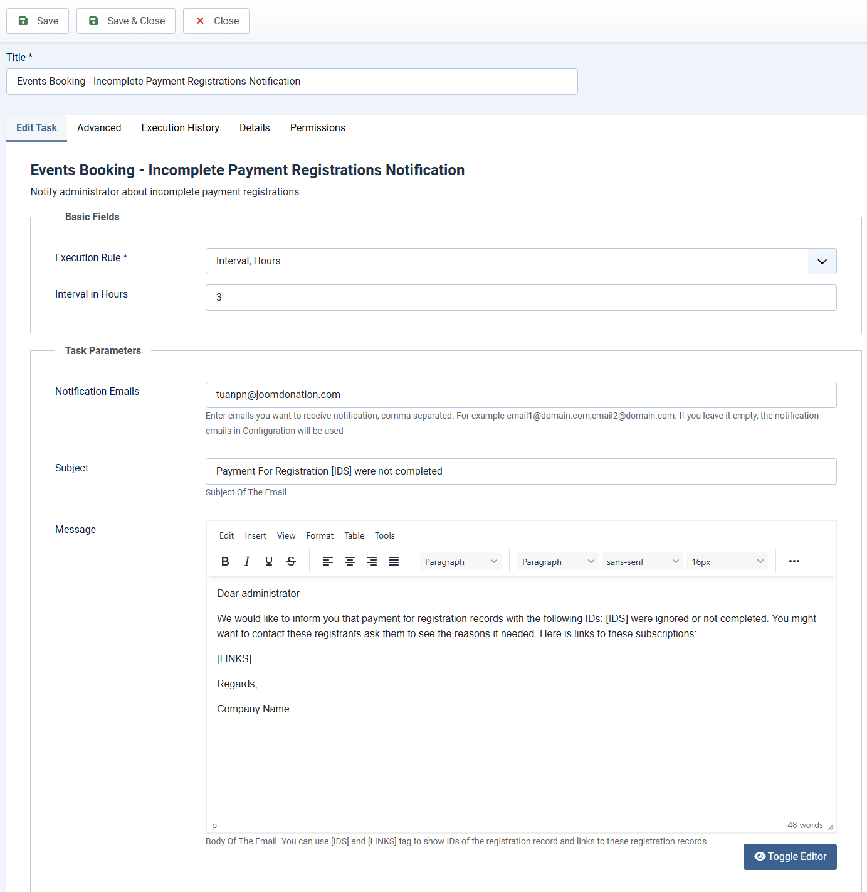

This scheduled task is used to send notification to administrators about the registration records which choose to use online payment methods such as PayPal, Stripe.... but did not complete payment (ignore payment process or payment failed for whatever reasons). Administrator can then contact these users to see why they did not make payment if needed. To use this feature:

## Create and configure the scheduled task

1. Go to **System -> Plugins**, make sure **Task - Events Booking** plugin is enabled.
2. Go to **System -> Scheduled Tasks**, press New button in the toolbar to create a new scheduled task for **Events Booking - Incomplete Payment Registrations Notification** task type.
3. Setup all required parameters, save it.

## Task Basic Fields
This scheduled task should be run every few hours. So you can setup **Basic Fields** to following values

- **Execution Rule**: Set to **Interval, Hours**
- **Interval in Hours**: Set to the number you want, for example, if you set it to 3, the task will be run every 3 hours.

## Task Parameters
- **Notification Emails**:  Enter the emails you want to receive notification about this incomplete payment registrations. Multiple emails are supported, just separate these emails by comma.
- **Subject**: Subject of the email. You can use [IDS] tag and it will be replaced with IDs of the incomplete payment registrations. For example: **Payment For Registrations [IDS] were not completed**
- **Message**: Body of the email. You can use [IDS] and [LINKS] tags in the message. For example:

Dear administrator

We would like to inform you that payment for registration records with the following IDs: [IDS] were ignored or not completed. You might want to contact these registrants ask them to see the reasons if needed. Here is links to these subscriptions:

[LINKS]

Regards,

Company Name