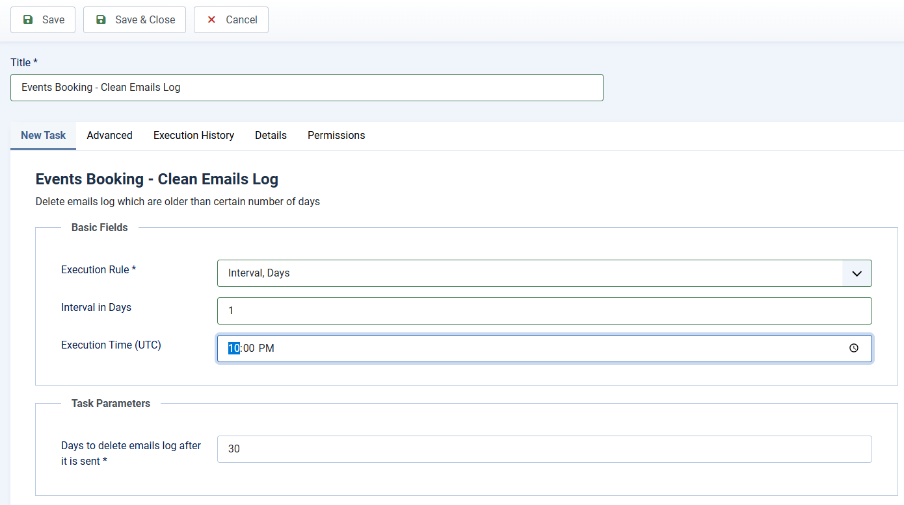

If you have **Log Emails** config option in Events Booking set to **Yes**, the system will store every emails sent from Events Booking in a database table and make these emails viewable from Events Booking, Tools -> Emails Log. This scheduled task is used to deletes emails older than certain Number Days (by default 30 days) from Emails Log to clean up un-necessary data and save hosting space. To use this feature:

## Create and configure the scheduled task

1. Go to **System -> Plugins**, make sure **Task - Events Booking** plugin is enabled.
2. Go to **System -> Scheduled Tasks**, press New button in the toolbar to create a new scheduled task for **Events Booking - Clean Emails Log** task type.
3. Setup all required parameters, save it.

## Task Basic Fields
This scheduled task should not be run so often. Run it every day should be enough. So you can setup **Basic Fields** to following values

- **Execution Rule**: Set to **Interval, Days**
- **Interval in Days**: Set to the number you want, for example, if you set it to 1, the task will be run every 1 day.
- **Execution Time (UTC)**: Choose the time in the day the task will be executed, for example 10:00 AM.

## Task Parameters
- **Days to delete emails log after it is sent**:  Enter a number here (for example 30) and emails from Emails Log will be deleted after 30 days.