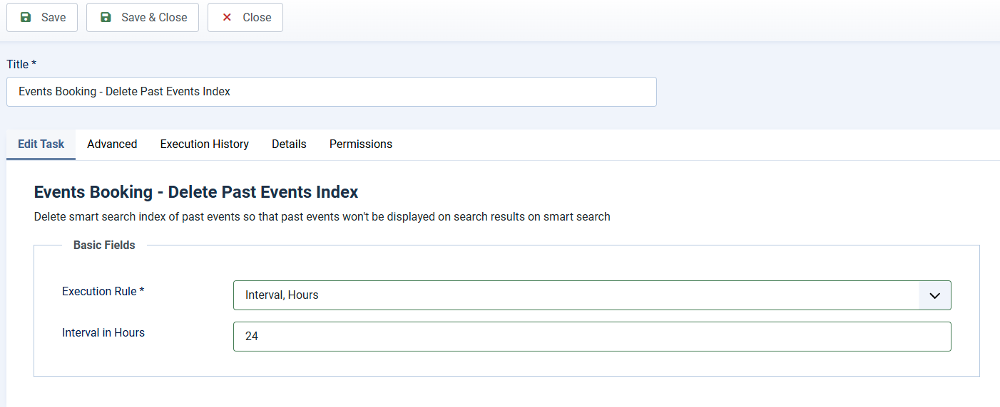

If you don't want your past events to be displayed on search result of Joomla core Smart Search, you can use **Events Booking - Delete Past Events Index** scheduled task. Each time the task is executed, it will find and delete index of events which are older than 24 hours compare to the current date time, thus prevent these past events are being searchable via smart search

## Create and configure the scheduled task

1. Go to **System -> Plugins**, make sure **Task - Events Booking** plugin is enabled.
2. Go to **System -> Scheduled Tasks**, press **New** button in the toolbar to create a new scheduled task for **Events Booking - Delete Past Events Index** task type.
3. Setup all required parameters, save it.

## Task Basic Fields
This scheduled task should not be run so often. Run it every 12 or 24 hours should be enough. So you can setup **Basic Fields** to following values

- **Execution Rule**: Set to **Interval, Hours**
- **Interval in Hours**: Set to the number you want, for example, if you set it to 12, the task will be run every 12 hours.