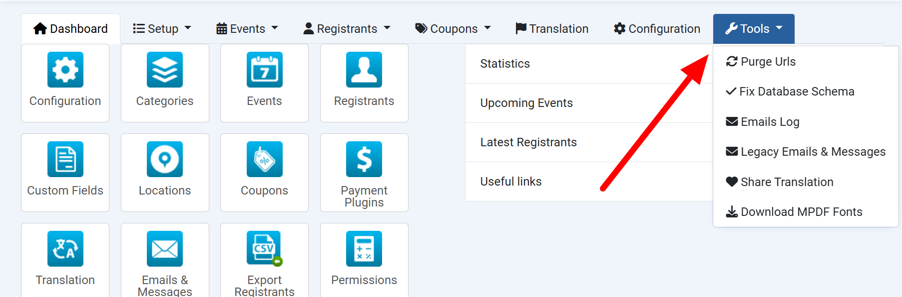

When you access to most of the pages in Events Booking backend (for example Events Booking -> Categories or Events Booking -> Events), at the right, there is a menu called **Tools** which you might need to use in some special cases as explained below:

## Tools -> Fix Database Schema
This tool is usually used when you update from old version of Events Booking to new version but the update process was failure for some reasons (or when you import Events Booking data from a different site - using an older version of Events Booking than the current site). Access to this menu item will help updating database schema to latest version and make sure Events Booking works properly on your site

In case you could not access to Events Booking for some reasons (because SQL error), the tool can be accessed directly via this URL https://domain.com/administrator/index.php?option=com_eventbooking&task=update.update (of course https://domain.com/administrator needs to be replaced with administrator URL of your site)

## Tools -> Purge URLs
Events Booking store all of it's URLs in database table called **eb_events**. These urls are **cached URLs**, mean urls might still point to old resources in some special case (for example, when you imported Events Booking data from a differnt site to this new site or you created an event with same title in the past, then delete it for some reason and re-create a new event with exactly same title/alias)

That's when you have to Purge URLs so that Events Booking will re-create new URLs and point it to new resource. Access to **Tools -> Purge** URLs usually help solving these issue

## Make field sort and searchable
By default, Events Booking only allow sorting and searching registrants for core fields (such as first_name, last_name, email....). If for you want to search for registration records base on data of a custom field, you can use this tool

1. Login to administrator area of your site
2. Access to this URL https://domain.com/administrator/index.php?option=com_eventbooking&task=tool.make_field_search_sort_able&field_id=100 . Of course:
- https://domain.com/administrator needs to be repalced with administrator URL of your site
- 100 will need to be replaced with the ID of the custom field which you want to be searchable

## Fix Row size too large error

On a multilingual website, specially when you have many languages installed, the system will need to add more fields to it's database tables to store data for these additional languages and could cause this **Row size too large (> 8126)** error. When it happens, you can follow the instructions below to get the issue sorted:

1. Login to administrator area of your site
2. Access to the two urls below (replace https://domain.com/administrator with administrator url of your site)
- https://domain.com/administrator/index.php?option=com_eventbooking&task=tool.fix_row_size
- https://domain.com/administrator/index.php?option=com_eventbooking&task=tool.fix_row_size2

## Resize Events Thumbnail

Sometime, you might want to change the event thumbnail size for your event. However, change the size (in Events Booking -> Configuration) will only affect thumbnails of new events created from now on

For existing events, normally, you will need to edit the event, save it so that thumbnail for the event will be generated with the new size. That would take much time in case you have many events, and that's why you can use this tool

1. Login to administrator area of your site
2. Access to the url below (replace https://domain.com/administrator with administrator url of your site)

https://domain.com/administrator/index.php?option=com_eventbooking&task=tool.resize_thumb_images

## Generate Missing Invoice Number
You might forgot to turn on invoice feature at the beginning and have some registration records do not have associated invoice number when it should. In this case, you can use this tool:

1. Login to administrator area of your site
2. Access to the url below (replace https://domain.com/administrator with administrator url of your site)

https://domain.com/administrator/index.php?option=com_eventbooking&task=tool.generate_missing_invoice_number

## Support Up To 6 Reminders

By default, Events Booking allows you to configure each event to send up to 3 reminders email. If you want to have more reminders, please use this hidden tool:

1. Login to administrator area of your site
2. If you want to send one extra reminder, access to this URL https://domain.com/administrator/index.php?option=com_eventbooking&task=tool.add_fourth_reminder_fields
3. If you want to send two extra reminders, access to this URL URL https://domain.com/administrator/index.php?option=com_eventbooking&task=tool.add_fifth_reminder_fields
4. If you want to send three extra reminders, access to this URL URL https://domain.com/administrator/index.php?option=com_eventbooking&task=tool.add_sixth_reminder_fields

This requires Events Booking 4.7.0+. And of course, https://domain.com/administrator need to be replaced with administrator URL of your site.

## Remove PDF Invoices

Each time Events Booking generates invoice, a file will be generated and store on server, it costs hosting space. If you want to delete/clean up these PDF invoice files, please:

1. Login to administrator area of your site
2. Access to this URL https://domain.com/administrator/index.php?option=com_eventbooking&task=tool.remove_pdf_invoices

Of course, https://domain.com/administrator need to be replaced with administrator URL of your site.

## Remove PDF Tickets

Each time Events Booking generates PDF Ticket, a file will be generated and store on server, it costs hosting space. If you want to delete/clean up these PDF Ticket files, please:

1. Login to administrator area of your site
2. Access to this URL https://domain.com/administrator/index.php?option=com_eventbooking&task=tool.remove_pdf_tickets

Of course, https://domain.com/administrator need to be replaced with administrator URL of your site.

## Remove PDF Certificates

Each time Events Booking generates PDF Certificate, a file will be generated and store on server, it costs hosting space. If you want to delete/clean up these PDF Ticket files, please:

1. Login to administrator area of your site
2. Access to this URL https://domain.com/administrator/index.php?option=com_eventbooking&task=tool.remove_pdf_certificates

Of course, https://domain.com/administrator need to be replaced with administrator URL of your site.

## Remove All Invoice, Ticket, Certificate pdf files

If you want to remove all pdf invoices, tickets, certificates in one step, please follow instructions below:

1. Login to administrator area of your site
2. Access to this URL https://domain.com/administrator/index.php?option=com_eventbooking&task=tool.clean_up_pdf_files

Of course, https://domain.com/administrator need to be replaced with administrator URL of your site.

## Remove orphan files
If you use **File** custom field on your site, there might be orphan files left on your server (files upload by users but not associated to any registration records - for example - uploaded but users did not process registration). For that, you might want to delete these orphan files to clean up, save hosting space:

1. Login to administrator area of your site
2. Access to the url below (replace https://domain.com/administrator with administrator url of your site)
- https://domain.com/administrator/index.php?option=com_eventbooking&task=tool.delete_orphan_files

