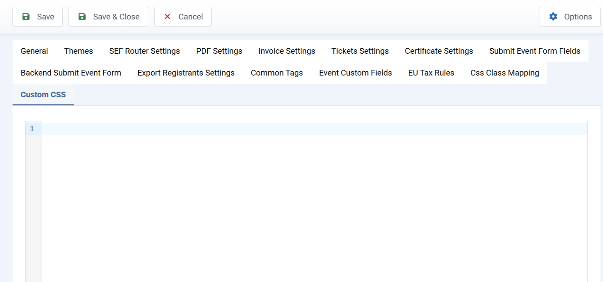

Sometime, you might want to customize layout of some pages in **Events Booking** to meet your requirement. Some notes below should be helpful to you if you have to do that:

## Customize CSS
If you want to add any css code to the extension, don't modify the css file directly. Go to **Events Booking**->**Configuration**, look at Custom CSS tab, add any custom css code you want there

If you don't see **Custom CSS** tab, please go to **System -> Plugins**, find and publish the plugin **Editor - CodeMirror**, after that, the tab will be available.

## Customize layout
If you want to customize the layouts in the extension, please use **Template Override** so that it won't be lost when upgrade your site to newer version of the extension. Below are  detailed instruction for common layouts which you might want to customize:

1. If you want to customize the **Calendar** page, take a copy of the file **components/com_eventbooking/themes/default/calendar/default_calendar.php**, place it to **PATH_TO_YOUR_SITE_TEMPLATE/html/com_eventbooking/calendar** folder and do any customization from there.
2. If you want to customize the **events list** page, depend on the layout you are using (default, table, timeline, columns), you will need to get a copy of one of the file (**events_default_layout.php**, **events_table_layout.php**, **events_timeline_layout.php**, **events_columns_layout.php**) in folder **components/com_eventbooking/themes/default/common**, **place** it to **PATH_TO_YOUR_SITE_TEMPLATE/html/com_eventbooking/common** folder, then do any customization you want in that file
3. If you want to customize the **event detail** page, take a copy of the file **components/com_eventbooking/themes/default/event/default.php**, place it to **PATH_TO_YOUR_SITE_TEMPLATE/html/com_eventbooking/event** folder and do any customization from there.
4. If you want to customize the **registration form** (individual registration, group registration, cart registration)page, take a copy of all the fields in  **components/com_eventbooking/themes/default/register** folder, place it to **PATH_TO_YOUR_SITE_TEMPLATE/html/com_eventbooking/register** folder and do any customization from there.

- For Individual Registration Form, the starting file is **components/com_eventbooking/themes/default/register/default.php**
- For Group Registration Form, the start file is components **/com_eventbooking/themes/default/register/group.php** . Each part of the registration form is from different file: **components/com_eventbooking/themes/default/register/number_members.php**, **components/com_eventbooking/themes/default/register/group_members.php**, **components/com_eventbooking/themes/default/register/group_billing.php**
- If you are using shopping cart, the start file is **components/com_eventbooking/themes/default/register/cart.php**2

5. If you want to customize the email layouts, the main file is **components/com_eventbooking/themes/default/emailtemplates/email.php**, it contains basic css and basic email layout structure. Each registration type has it own email layout:

- For individual registration, the file is **components/com_eventbooking/themes/default/emailtemplates/email_individual_detail.php**
- For group registration, the file is **components/com_eventbooking/themes/default/emailtemplates/email_group_detail.php**
- For shopping cart, the file is **components/com_eventbooking/themes/default/emailtemplates/cart.php**

Once the change is done, copy the modified files to PATH_TO_YOUR_SITE_TEMPLATE/html/com_eventbooking/emailtemplates folder.

6. If you want to customize frontend event submission form, depends on the the layout you are using (configurable in Events Booking -> Configuration, Themes tab, **Frontend event submission form layout** config option:
* If you use Simple layout, take a copy of the file **components/com_eventbooking/themes/default/event/simple.php**, place it to **PATH_TO_YOUR_SITE_TEMPLATE/html/com_eventbooking/event** folder and do any customization from there
* If you use Default layout, take a copy of one of the follow files form.php, form_discount_settings.php, form_fields.php, form_general.php, form_group_rates.php, form_misc.php, form_recurring_settings.php from **components/com_eventbooking/themes/default/event/** folder, place it inside **PATH_TO_YOUR_SITE_TEMPLATE/html/com_eventbooking/event** folder and do any customization from there